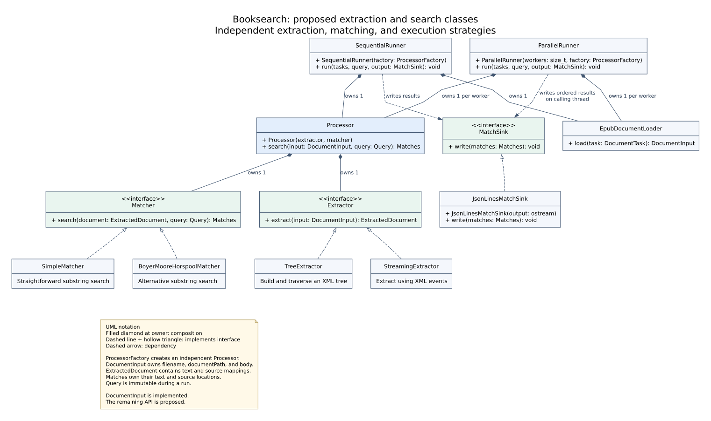

# Extraction and search architecture

`DocumentInput` is implemented. The remaining classes and processing snippets
describe a proposed API to develop through TDD.



The editable diagram source is [classes.dot](classes.dot). Regenerate the SVG with:

```sh
dot -Tsvg docs/classes.dot -o docs/classes.svg
```

## Responsibilities and ownership

| Class | Responsibility |
| --- | --- |
| `EpubDocumentLoader` | Decompress a document entry from an EPUB into an owning `DocumentInput`. |
| `Extractor` | Convert XHTML into an `ExtractedDocument`: readable text plus mappings to source locations. |
| `TreeExtractor` | Implement extraction by building and walking an XML tree. |
| `StreamingExtractor` | Implement the same extraction contract using XML events, avoiding a full XML tree. |
| `Matcher` | Search an `ExtractedDocument` using a query and return matches with source locations. |
| `SimpleMatcher` | Provide the initial, straightforward substring-search implementation. |
| `BoyerMooreHorspoolMatcher` | Provide an alternative substring-search algorithm with the same observable behavior. |
| `Processor` | Own one extractor and one matcher; extract and search one loaded document sequentially. |
| `SequentialRunner` | Own one loader and one processor; load and process tasks in input order. |
| `ParallelRunner` | Own one loader and one processor per worker; distribute tasks through a bounded queue and collect results. |
| `MatchSink` | Accept completed document results on the calling thread, in input order. |
| `JsonLinesMatchSink` | Serialize those results to an output stream. The search-result JSON schema remains to be defined. |

`Processor` is a concrete composition of strategies. `Extractor`, `Matcher`, and
`MatchSink` are interfaces with virtual destructors. No runner base class is
needed for these examples. The runners take a processor factory so each worker
gets independent mutable state.

The signatures in the diagram are abbreviated UML: `extract`, `search`, `load`,
and `run` may fail. Their error and cancellation contracts remain to be defined.

## Document data

A `DocumentTask` identifies an EPUB on disk, its display path for source
locations, and an XHTML entry inside the archive. The proposed loader produces
the implemented [booksearch::DocumentInput](../include/booksearch/document_input.hpp)
aggregate. Its three `std::string` fields own their contents:

```cpp
#include "booksearch/document_input.hpp"

booksearch::DocumentInput input{
    .filename = "example.epub",
    .documentPath = "OEBPS/chapter01.xhtml",
    .body = R"(<html xmlns="http://www.w3.org/1999/xhtml"><body><p>Hello.</p></body></html>)",
};
```

`filename` is the EPUB filename or its path relative to the input directory.
`documentPath` is relative to the EPUB archive root. `body` contains the entire
decompressed XHTML source, including the document root, head, and markup; it is
not limited to the HTML `<body>` element. A `struct` fits this data aggregate:
there are no validation rules or private state to enforce yet.

The XML parser handles the source encoding; extracted text is UTF-8. The
`ExtractedDocument` retains the mapping from searchable text to the original
elements, including document-root-relative element paths and anchors. It is
owned by the current processing invocation, and returned matches own the data
needed after that invocation finishes.

One XHTML document is the initial task and search boundary. Matching state never
continues into another document. Whether a match may cross text blocks within
that document remains a search-policy decision shared by every matcher. A later
chapter restriction can select a scope inside a document while preserving its
original element paths.

Both extractor implementations initially materialize an `ExtractedDocument`.
The streaming extractor removes the XML tree allocation; this interface does not
promise constant memory for an entire document.

## Usage snippets

These snippets use the proposed API. `Query::literal` represents a case-sensitive
literal query; both matching algorithms must implement the same match and
location policies. The following setup is shared by the runner examples:

```cpp
std::vector<DocumentTask> tasks{
    {.archive = "books/example.epub",
     .epub = "example.epub",
     .document = "OEBPS/chapter01.xhtml"},
    {.archive = "books/example.epub",
     .epub = "example.epub",
     .document = "OEBPS/chapter02.xhtml"},
};

const auto query = Query::literal("example paragraph");
JsonLinesMatchSink output{std::cout};

auto make_processor = [] {
    return std::make_unique<Processor>(
        std::make_unique<TreeExtractor>(),
        std::make_unique<SimpleMatcher>());
};
```

Run sequentially:

```cpp
SequentialRunner runner{make_processor};
runner.run(tasks, query, output);
```

Alternatively, run the same work with four workers:

```cpp
ParallelRunner runner{4, make_processor};
runner.run(tasks, query, output);
```

Select a different matching algorithm by changing the factory:

```cpp
auto make_optimized_processor = [] {
    return std::make_unique<Processor>(
        std::make_unique<TreeExtractor>(),
        std::make_unique<BoyerMooreHorspoolMatcher>());
};

ParallelRunner runner{4, make_optimized_processor};
runner.run(tasks, query, output);
```

Use `StreamingExtractor` in the factory to compare extraction strategies
independently. A runner invokes the factory once per worker, reusing each
processor for successive documents. The sequential runner invokes it once.

For a direct call, load one document and use the processor without a runner:

```cpp
EpubDocumentLoader loader;
auto processor = make_processor();
const auto document = loader.load(tasks.front());
const auto matches = processor->search(document, query);
output.write(matches);
```

## Parallel execution contract

The task list stays valid until `run` returns. Each worker loads its next task
and searches that document sequentially. Archive-reader state, parsing state,
matching scratch space, and allocation arenas belong to that worker. Queries
are immutable during a run; matcher implementations must support concurrent
reading of query data or keep algorithm-specific mutable state in the worker.

Only the calling thread writes to the sink. The parallel runner preserves task
order and preserves match order within each document, giving the same results
as the sequential runner. It bounds in-flight work and buffered result bytes,
with temporary-file spooling if needed to preserve order without unbounded
memory. That buffering policy is part of the future implementation.

Parallelism improves throughput across documents. A single document remains
sequential in this initial design. Benchmarks should change one strategy at a
time and verify identical results before comparing performance.

## Building and testing the implemented code

The current code requires a C++23 compiler and CMake 3.25 or newer. The test uses
CTest and the C++ standard library, with no external dependencies:

```sh
cmake -S . -B build -DCMAKE_BUILD_TYPE=Debug
cmake --build build
ctest --test-dir build --output-on-failure
```
